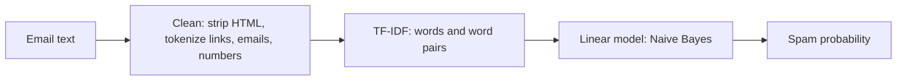

# 🔨 HAMMER: Email Spam Detector

**Scan. Score. Block.** Paste an email and HAMMER tells you whether it looks like spam or a legitimate message, how confident it is, and exactly which words drove the decision.

The trained machine learning model runs **entirely in your browser**. The site is fully static, there is no server, and the emails you paste never leave your device.


-black)

> **Live demo:** open the link in this repository's *About* section (top right of the GitHub page).

<!-- Add a screenshot or short GIF of the scanner here, for example:  -->

---

## Table of contents

- [Overview](#overview)
- [Features](#features)
- [How it works](#how-it-works)
- [Reading a result](#reading-a-result)
- [Results](#results)
- [Project structure](#project-structure)
- [Getting started](#getting-started)
- [Retraining the model](#retraining-the-model)
- [Limitations](#limitations)
- [Roadmap](#roadmap)
- [Tech stack](#tech-stack)
- [Acknowledgements](#acknowledgements)

---

## Overview

Most spam filters are black boxes. HAMMER is built to be understood as well as used:

- **Private by design.** Classification happens in JavaScript on the visitor's device. No API calls, no uploads, no tracking.
- **Explainable.** Every verdict comes with the words that pushed the score toward spam or toward legitimate, plus a step-by-step breakdown of the real numbers behind it.
- **Reproducible.** Training lives in Python (`training/`), and the exported model is verified against the browser implementation.
- **Zero infrastructure.** Open `index.html` locally, or host the folder on any static host.

## Features

**Scanner**
- Spam probability with a meter and a warning when the result is close to the decision line
- Highlights the words in your email that influenced the score, in red (toward spam) or green (toward legitimate)
- Ready-made Spam, Phishing and Normal examples to try instantly
- Live word and character counter, and a `Ctrl` / `Cmd` + `Enter` shortcut to scan

**Transparency**
- "How HAMMER decided" panel that fills in with the actual numbers from your email: what was cleaned, which features matched, the bias and evidence that make up the score, and the final probability
- Model report section with the model used, number of emails trained on, test accuracy, wrongly flagged real emails and missed spam

**Interface**
- Dark "smoked glass" design with scroll animations, a hammer-strike intro and a side navigation rail
- Responsive layout for desktop and mobile
- Respects the system `prefers-reduced-motion` setting

**Training**
- Retrain on one or many CSV datasets with a single command
- Datasets are merged and de-duplicated automatically

## How it works



| Step | What happens |
|---|---|
| **1. Clean** | HTML is stripped. Links, email addresses and numbers are replaced with placeholder tokens so the model learns patterns rather than exact values. |
| **2. Extract features** | Common stop words are dropped. Single words and word pairs are matched against the 20,000 TF-IDF features learned during training. |
| **3. Score** | Each matched feature has a learned weight: positive pushes toward spam, negative toward legitimate. The weighted TF-IDF values are summed with a starting bias. |
| **4. Decide** | The score is passed through a logistic function to give a probability between 0% and 100%. Above 50% the email is labeled spam. |

Training happens in Python (`training/`). The learned weights are exported to `model.js`, and `spam.js` repeats the same cleaning, TF-IDF and scoring in JavaScript.

**Parity check:** the JavaScript version was compared with the Python model on 300+ emails. Probabilities agree to within 1e-7 and no predictions differ.

## Reading a result

| Element | Meaning |
|---|---|
| **Verdict** | *Likely spam* or *Looks legitimate*, decided at the 50% line |
| **Spam probability** | The model's confidence that the email is spam |
| **Borderline warning** | Shown when the probability is between 35% and 65%. Treat these results with caution. |
| **Pushing toward spam / legitimate** | The strongest features on each side of the decision |
| **Highlighted email** | Your text with influential words marked in place |

## Results

Trained on 5,695 emails (Enron-based Kaggle dataset), split 80/20 into 4,556 training and 1,139 test emails. All figures below are measured on the held-out test set.

| Model | Accuracy | Real emails wrongly flagged | Spam missed |
|---|---|---|---|
| **Naive Bayes (used)** | **99.2%** | **2** | 7 |
| Logistic Regression | 98.9% | 10 | 2 |

Spam-class precision for the chosen model is 99.3% and recall is 97.5%.

**Why Naive Bayes?** In an inbox, wrongly sending a real email to spam is usually the more costly mistake than letting one spam message through. Naive Bayes flags five times fewer real emails than Logistic Regression (2 versus 10), so it was chosen even though it misses a few more spam messages.

## Project structure

```
index.html              the website (UI and interaction)
spam.js                 classifier logic (runs in the browser)
model.js                exported trained model
vercel.json             tells Vercel this is a static site
training/
  train_export.py       trains the models and writes ../model.js
  preprocess.py         email cleaning used in training
  requirements.txt      Python dependencies for training
  data/                 put your CSV datasets here (not committed)
```

`index.html` loads `model.js` and `spam.js` from the same folder, so keep the three files together.

## Getting started

### Run the website locally

Open `index.html` in any browser. No installation is needed. The page works offline, except that the Google Sans Flex font is loaded from Google Fonts and falls back to a system font without a connection.

### Deploy

Because the site is static, deploy the repository root to any static host. Vercel is configured through `vercel.json`, and GitHub Pages works as well.

## Retraining the model

Use this to retrain, add more data, or work on the project from a different computer.

**1. Install the tools**
- Python 3.11 or newer (check with `python --version`)
- Git (check with `git --version`)

**2. Get the code**
```bash
git clone https://github.com/AKIB2005/email-spam-detector.git
cd email-spam-detector/training
```

**3. Create a virtual environment and install dependencies**

Windows:
```bash
python -m venv venv
venv\Scripts\activate
pip install -r requirements.txt
```

Mac / Linux:
```bash
python3 -m venv venv
source venv/bin/activate
pip install -r requirements.txt
```

**4. Add your data**

Download the email spam dataset from Kaggle and put the CSV file in `training/data/`. Every `*.csv` in that folder is loaded and merged, and duplicates are removed, so you can train on more data by adding more files.

Each file needs:

| Column | Accepted names | Accepted values |
|---|---|---|
| Text | `text`, `message`, `body`, `email`, `content` | the email text |
| Label | `spam`, `label`, `category`, `class` | `1` / `0` or `spam` / `ham` |

**5. Train**
```bash
python train_export.py
```
This prints accuracy, false positives and false negatives for both models, then rewrites `../model.js`.

**6. Check and publish**

Open `index.html` to test the new model, then push the change:
```bash
cd ..
git add model.js
git commit -m "Retrain model with more data"
git push
```
Vercel or GitHub Pages redeploys automatically.

**Tips for a better model:** add a modern spam dataset (such as SpamAssassin), add emails from your own inbox, and compare false positives before and after retraining.

## Limitations

- **Dataset age.** The model is trained on the Enron corpus, so it is best at classic spam and phishing. Modern marketing emails can get uncertain scores.
- **Dataset quirks.** Some words reflect Enron-specific patterns. For example, "password" leans legitimate because of internal IT emails in the corpus.
- **Text only.** The model does not see sender reputation, headers, links' destinations or attachments.
- **Not a security product.** HAMMER is a learning and demonstration project. Do not rely on it as your only defense against phishing.

## Roadmap

- [ ] Add a second dataset with modern spam and compare results
- [ ] Try a small transformer model (DistilBERT) and compare accuracy and speed
- [ ] Gmail integration to scan a real inbox
- [ ] Add precision, recall and a confusion matrix to the in-app model report

## Tech stack

Python · scikit-learn · pandas · JavaScript · HTML/CSS · Vercel

## Acknowledgements

- Enron-based email spam dataset from Kaggle
- Google Sans Flex typeface, served by Google Fonts under the SIL Open Font License