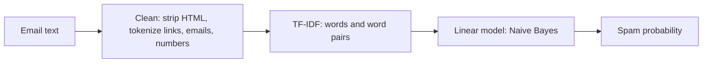

# 📧 Email Spam Detector

A machine learning project that tells you whether an email looks like **spam** or **legitimate (ham)**.
The trained model runs **entirely in the browser**, so the site is fully static: no server, and pasted emails never leave your device.

> **Live demo:** open the link in this repository's *About* section (top right of the GitHub page).

## Features

- Spam probability with a meter and a "borderline" warning
- Highlights the words in your email that pushed the score toward spam or legitimate
- Light and dark theme (follows your system, remembers your choice)
- Model report: accuracy, precision, recall and a confusion matrix
- Retrain on one or many CSV datasets with a single command

## How it works



Training happens in Python (`training/`). The learned weights are exported to `model.js`, and `spam.js` repeats the same cleaning, TF-IDF and scoring in JavaScript.
The JavaScript version was checked against the Python model on 300+ emails: probabilities agree to within 1e-7 and no predictions differ.

## Results

Trained on 5,695 emails (Enron-based Kaggle dataset). Tested on a held-out 20% (1,139 emails).

| Model | Accuracy | Real emails wrongly flagged | Spam missed |
|---|---|---|---|
| Naive Bayes (used) | 99.2% | 2 | 7 |
| Logistic Regression | 98.9% | 10 | 2 |

Naive Bayes is used because it wrongly flags far fewer real emails, which is the more costly mistake in an inbox. Spam-class precision is 99.3% and recall is 97.5%.

## Project structure

```
index.html              the website
spam.js                 classifier logic (runs in the browser)
model.js                exported trained model
vercel.json             tells Vercel this is a static site
training/
  train_export.py       trains the model and writes ../model.js
  preprocess.py         email cleaning used in training
  requirements.txt      Python dependencies for training
  data/                 put your CSV datasets here (not committed)
```

## Run the website locally

Open `index.html` in any browser. No installation or internet is needed.

## Train the model on another PC

Use this to retrain, add more data, or work on the project from a different computer.

**1. Install the tools**
- Python 3.11 or newer (check with `python --version`)
- Git (check with `git --version`)

**2. Get the code**
```
git clone https://github.com/AKIB2005/email-spam-detector.git
cd email-spam-detector/training
```

**3. Create a virtual environment and install dependencies**

Windows:
```
python -m venv venv
venv\Scripts\activate
pip install -r requirements.txt
```
Mac / Linux:
```
python3 -m venv venv
source venv/bin/activate
pip install -r requirements.txt
```

**4. Add your data**

Download the email spam dataset from Kaggle and put the CSV file in `training/data/`.
Every `*.csv` in that folder is loaded and merged, and duplicates are removed, so you can train on more data by adding more files.
Each file needs a text column (`text`, `message`, `body`, `email` or `content`) and a label column (`spam`, `label`, `category` or `class`, with values 1/0 or spam/ham).

**5. Train**
```
python train_export.py
```
This prints accuracy, false positives and false negatives for both models, then rewrites `../model.js`.

**6. Check and publish**

Open `index.html` to test the new model. Then push the change:
```
cd ..
git add model.js
git commit -m "Retrain model with more data"
git push
```
Vercel or GitHub Pages redeploys automatically.

**Tips for a better model:** add a modern spam dataset (such as SpamAssassin), add emails from your own inbox, and compare false positives before and after retraining.

## Limitations

- Trained on the Enron corpus, so it is best at classic spam and phishing. Modern marketing emails can get uncertain scores.
- Some words come from Enron-specific patterns (for example, "password" leans legitimate because of internal IT emails).
- It reads text only, not sender reputation, headers or attachments.

## Ideas for next steps

- Add a second dataset with modern spam and compare results
- Try a small transformer model (DistilBERT) and compare accuracy and speed
- Gmail integration to scan a real inbox

## Tech

Python · scikit-learn · pandas · JavaScript · HTML/CSS · Vercel
